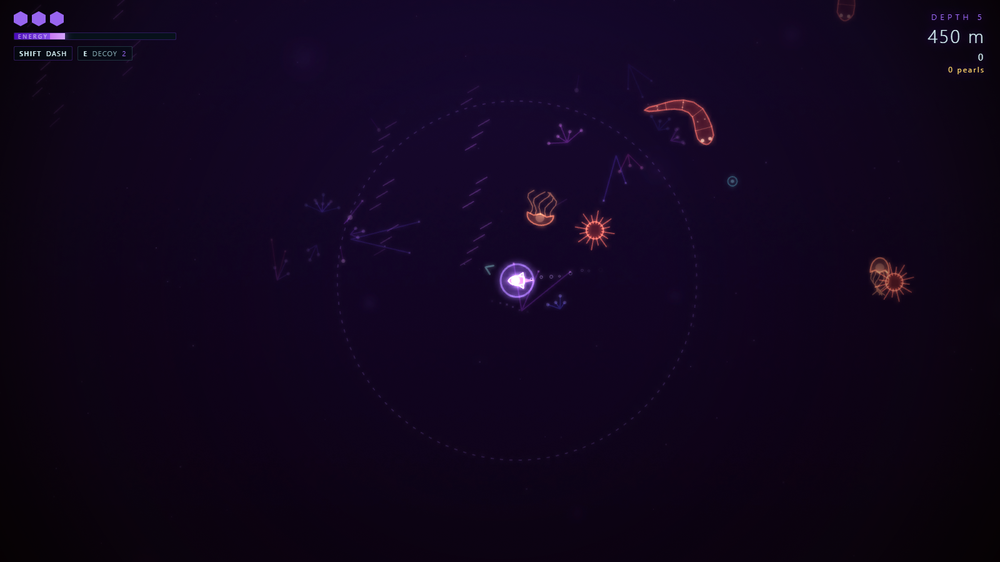
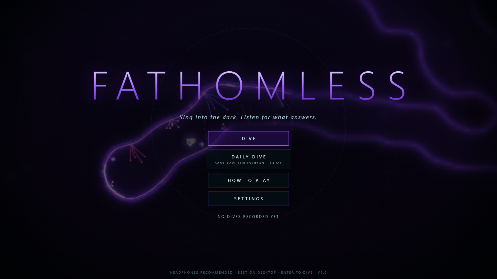

# FATHOMLESS

**Sing into the dark. Listen for what answers.**

A sonar-stealth roguelite for the browser. You pilot a tiny submersible down twelve depths of lightless, procedurally generated caves. You cannot see. You can only *sing*: every ping you send paints the cave in glowing echoes — and wakes whatever lives in it.

**[▶ Play it here](https://fansist.github.io/fathomless/)** &nbsp;·&nbsp; desktop browser, keyboard (or gamepad), headphones recommended.





## How it plays

- **Ping to see.** Hold <kbd>Space</kbd> (or the mouse button) to charge a sonar ping, release to send it. A quick tap is a whisper; a full charge lights up the whole cavern.
- **But sound travels.** Creatures hunt by *hearing*. Loud pings and sprinting carry far; drifting slowly is silent.
- **Echoes fade, the map remains.** Walls you have mapped stay faintly drawn. Creature "ghosts" show where something *was*, never where it is.
- **Decoy buoys** (<kbd>E</kbd> / right click) beep and lure hunters away. **Dash** (<kbd>Shift</kbd>) is a burst of speed — and a shout.
- Find the glowing gate on every depth. Pick one refit between dives. Twelve depths to the Heart… and a leviathan that is listening.

### Controls

| Action | Keys |
| --- | --- |
| Swim | <kbd>W</kbd><kbd>A</kbd><kbd>S</kbd><kbd>D</kbd> or arrows |
| Charge / send ping | hold & release <kbd>Space</kbd> or left mouse |
| Dash | <kbd>Shift</kbd> |
| Drop decoy | <kbd>E</kbd> or right mouse |
| Pause · Mute · Fullscreen | <kbd>P</kbd>/<kbd>Esc</kbd> · <kbd>M</kbd> · <kbd>F</kbd> |
| Menus | mouse, <kbd>Tab</kbd>/arrows + <kbd>Enter</kbd>, <kbd>1</kbd><kbd>2</kbd><kbd>3</kbd> to pick a refit; <kbd>Enter</kbd> on the title dives |
| Gamepad | stick swim, A (hold) ping, B dash, X decoy, Start pause; d-pad navigates menus |

### The deep

| Biome | Depths | Dwellers |
| --- | --- | --- |
| Twilight Zone | 1–3 | drifting jellies; spiny urchins from depth 2; the first eel at depth 3 |
| Midnight Zone | 4–6 | more of everything, lure-bearing anglers from depth 5, ocean currents |
| Abyssal Plain | 7–9 | denser caves full of hunters |
| Hadal Trench | 10–12 | everything — and the Leviathan |

Beat depth 12 and you can keep descending in endless mode. There is also a **Daily Dive**: the same cave for everyone, every day (it rolls over at 00:00 UTC). Abandoning a dive still banks your score.

If the game runs slowly on your machine it quietly turns off the glow effect, then lowers the render resolution; both can be set in Settings.

## Under the hood

Everything is hand-written vanilla JavaScript — no engine, no build step, no image or audio files.

- **Caves** are carved by random-walk "worms" and chambers on a coarse grid, converted into a smoothed **signed distance field**. The same field drives collisions (smooth wall sliding), navigation clearance and the sonar.
- **Sonar** is ray-marched through the distance field: each ping is a fan of 300–600 rays whose hit points are revealed as the wavefront reaches them, shaded by surface angle, with line-of-sight "lit water" volumes and a persistent memory map.
- **Creatures** are blind state machines that react to *noise events* and navigate with BFS flow fields on per-size clearance grids.
- **Audio** is 100% synthesized with Web Audio: chirps, a rain of echo ticks derived from the real ray hits, generative music, a heartbeat that follows nearby danger, whale-song.
- **Rendering** is additive Canvas2D vector art with a multi-pass downsampled bloom.

## Run it locally

```bash
git clone https://github.com/Fansist/fathomless.git
cd fathomless
npm run serve        # http://localhost:8765  (any static server works)
```

Developer helpers live in `tools/` (headless-Chrome harness via `puppeteer-core`, world-generation fuzz tests, bot runs). In the browser console `__fathom` exposes the game, and URL params like `?start=1&seed=abc&depth=7&god=1` jump straight into a level.

## License

MIT © Fansist
